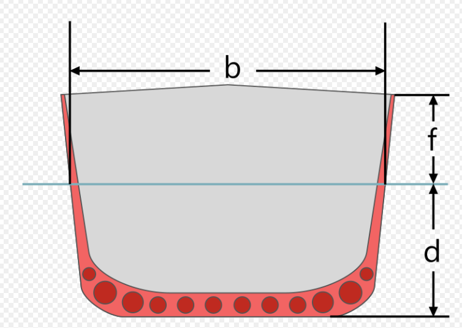

Due Friday 30 Oct, 1700, via [Sakai](). Textbook: Chapters 7 and 8 ([Textbook](../../resources/textbook.qmd)).

## Introductory Notes

The submission mechanics are the same as for the previous assignments ([Assignment 1](../w01_modeling_scripts/assignment.qmd) has the details):

* run each live script from a clean workspace - use `clear` appropriately to ensure no leftover variables
* save live code files with embedded outputs
* use the exact case-sensitive file names below, and
* verify your Sakai upload.

Two of the exercises read data from a `.mat` file. Put the `.mat` file in the same folder as the live script that loads it. You do not need to submit the `.mat` files.  You can assume that the files will be available in the same folder when your code is run.

## Exercise 1: Buoy Sensor Data

This exercise works with the `NaN` and `Inf` values, logical arrays and the `find` function.

The prototype live script [sensor_clean.m](/book/w04_datatypes_fzero/assign/sensor_clean.m) defines the exercise. You will also need the data file [sensordata.mat](/book/w04_datatypes_fzero/assign/sensordata.mat). Complete the missing sections of code and submit `sensor_clean.m`.

## Exercise 2: Contact Structure

In this exercise you will work with MATLAB's struct data type, which groups related data under named fields. Using a set of simulated radar contacts, you will practice inspecting, updating, and reporting on struct data — skills you will use throughout MATLAB and its toolboxes.

* The live script [contact_gen.m](/book/w04_datatypes_fzero/assign/contact_gen.m) generates the struct that we'll use for the exercise. You do not need to edit it, but you do need to run it to create the `contactdata.mat` file. Read the file to understand its contents, i.e., how the MATLAB `struct` is created.  You do not need to submit this file.
* The prototype live script [contact.m](/book/w04_datatypes_fzero/assign/contact.m) provides the instructions and code blocks for you to complete. Submit `contact.m`.

## Exercise 3: USV Draft

Topic: zero-finding and function handles (inspired by PMM Exercise 8.2).

For this exercise, submit a live script named `usv_draft.m`. You will develop this script from scratch based on the description below.

The [draft](https://en.wikipedia.org/wiki/Draft_(hull)) of a vessel is the depth of the hull below the waterline, shown as $d$ in this image:

{width=400px}

We want to estimate the draft of the [WAM-V 16](https://wam-v.com/bestsellers) unmanned surface vessel (USV):

{width=500px}

We'll approximate each of the two hulls as a cylinder. The volume of a single cylinder below the waterline is

$$
V = L \left( R^2 \arccos\left(1 - \frac{d}{R}\right) - (R - d)\sqrt{R^2 - (R - d)^2} \right)
$$

where

* $d$ — draft of the vessel
* $R$ — radius of the hull
* $L$ — length of the hull

Note: You don't need to understand the geometry here; you can take the equation above as given.

According to the law of buoyancy, at equilibrium the mass of the displaced water equals the mass of the vessel.

| Parameter | Value |
|---|---|
| Radius of hull, $R$ | 0.213 m |
| Length of hull, $L$ | 5 m |
| Mass of vessel, $m$ | 200 kg |
| Density of water, $\rho$ | 1000 kg/m³ |

1. Write an expression for buoyancy equilibrium, where the mass of the water displaced by both hulls equals the mass of the vessel. Document the equation by writing it in your live script.
2. Rearrange the equation so that the right side is zero. Our goal is to find values of $d$ that are the roots of this equation. Again, write the model as a mathematical expression in your live script. In general, when using software to implement a complex expression, it is good practice to explicitly write the expression before starting the software implementation. This helps because we have a clear idea of what the software algorithm is supposed to do. If we skip this step, it is harder to debug because we don't know whether there is a mistake in the code or a mistake in the underlying model.
3. Write a MATLAB local function that implements this mathematical model.
4. Test the function with some reasonable values of $d$. Keep in mind that the equation above for submerged volume is only applicable for $0 \le d \le 2R$. Verify that your equilibrium equation changes sign as $d$ goes from small to large.
5. Use the `fzero` function, with a function handle to your local function, to find a root near an initial guess for $d$.
6. To check your answer, plot the values of your function as $d$ varies between zero and $2R$. Your solution should correspond to where the plot crosses the horizontal axis.

Bonus: Annotate your plot by adding markers for the location of your initial estimate and the solution provided by `fzero`.  (Feel free to use AI to help with the annotation, but make sure you understand what the markers represent.)

### Submit and Verify

Submit three `.m` files:

- Exercise 1: `sensor_clean.m`
- Exercise 2: `contact.m`
- Exercise 3: `usv_draft.m`
