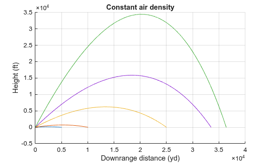

## Exercise 1: Pendulum Simulation

Adapted from [MIT 2.003SC Engineering Dynamics, OpenCourseWare](https://ocw.mit.edu/courses/2-003sc-engineering-dynamics-fall-2011/), Problem Set 4.

In a classic dynamics course we formulate the equations of motion (using Newton-Euler equations, Lagrange's equations or Hamiltonian mechanics) and then infer the behavior from analytical solutions to those equations. In this exercise we use computation to simulate the equations of motion and compare the simulation to the analytical results.

The prototype live script [pendulum.m](/book/w06_matrices_secondorder/assign/pendulum.m) defines the exercise. It gives the model and the constants, and it gives the closed-form solution of the linearized, small-angle model, which you will use to check your simulation. Open it as a live script, fill in the missing equations, code and written answers in each section, and submit `pendulum.m`.

## Exercise 2: Reproducing a Naval Range Table

Data from Bureau of Ordnance, [Ordnance Pamphlet 770, Range Tables for the 16-inch/50 Caliber Gun](https://www.eugeneleeslover.com/USN-GUNS-AND-RANGE-TABLES/OP-770.php), October 1941.

A range table tells a gunnery officer what angle of elevation puts a shell on a target at a given range, and how long the shell is in the air. Before computers, these tables were built from proving-ground firings and months of hand calculation. In this exercise you simulate the flight of a shell in two dimensions, as in Chapter 13, and test your model against the range table for the [16-inch/50 Mark 7 guns](https://en.wikipedia.org/wiki/16-inch/50-caliber_Mark_7_gun) of the [*Iowa*-class battleships](https://en.wikipedia.org/wiki/Iowa-class_battleship). As with the pendulum, the point is to find out where a simple model can be trusted and where it cannot.

### Range table

The table below is an excerpt of five rows, from short range to the maximum range, for the 2700 lb armor-piercing projectile at an initial velocity of 2500 ft/s. The maximum ordinate is the highest point of the trajectory.

| Range (yd) | Angle of elevation | Time of flight (s) | Striking velocity (ft/s) | Maximum ordinate (ft) |
|---:|---:|---:|---:|---:|
| 5,000 | 2° 21.3′ | 6.29 | 2279 | 158 |
| 10,000 | 5° 02.9′ | 13.24 | 2074 | 703 |
| 25,000 | 16° 01.7′ | 39.30 | 1632 | 6,230 |
| 35,000 | 27° 22.3′ | 63.22 | 1556 | 16,120 |
| 42,345 | 45° 00.0′ | 95.32 | 1686 | 36,610 |

Copy the same data into your script as a matrix. The columns are range (yd), elevation degrees, elevation minutes, time of flight (s), striking velocity (ft/s) and maximum ordinate (ft).

```matlab
rt = [ 5000   2  21.3    6.29   2279     158
      10000   5   2.9   13.24   2074     703
      25000  16   1.7   39.30   1632    6230
      35000  27  22.3   63.22   1556   16120
      42345  45   0.0   95.32   1686   36610];
```

### Model

Let $x$ be the downrange distance and $y$ the height of the shell, both in feet, with time in seconds. Drag acts opposite to the velocity and grows with the square of the speed, so the equations of motion are

$$
\begin{aligned}
\ddot{x} &= -d_p \, \dot{x} \sqrt{\dot{x}^2 + \dot{y}^2} \\
\ddot{y} &= -g - d_p \, \dot{y} \sqrt{\dot{x}^2 + \dot{y}^2}
\end{aligned}
$$

where $g = 32.174$ ft/s² and the drag parameter is $d_p = 5.81 \times 10^{-6}$ 1/ft. The value of $d_p$ already includes the shell's mass and shape, and it is valid only in feet and seconds, so do the simulation in those units. It was chosen so that the model matches the table at 25,000 yd.

The shell is fired from the origin with initial velocity $v_0 = 2500$ ft/s at an angle of elevation $\theta$ above the horizontal:

$$
x(0) = 0, \quad y(0) = 0, \quad \dot{x}(0) = v_0 \cos\theta, \quad \dot{y}(0) = v_0 \sin\theta.
$$

### Exercise

For this exercise, submit a live script named `range_table.m`.

1. Before writing any code, convert the two second-order equations into a system of four first-order equations. In your live script, define the four-element state vector and write the model in state-space form. As with the pendulum, the order of the elements is your choice, but be consistent.
2. Write a local rate function `shell_rate(t, xx, dp)` that takes the drag parameter (scalar) as a third input argument. Test it at the muzzle for a level shot, $\theta = 0$. Does the horizontal deceleration, $d_p v_0^2$, match what your function returns?
3. `ode45` expects a rate function with exactly two inputs, `(t, xx)`. Use an anonymous function to wrap `shell_rate` with a fixed value of `dp`, as in the Wednesday lesson, and simulate the shot for the 25,000 yd row of the table, in the middle of the gun's range. Use a finely spaced `tspan` (for example, `0:0.01:120`) so the solution is dense enough to read values from directly. Use `find` to locate the first sample where the shell is below the level of the gun, and report the model's
    a. range, in yards,
    b. time of flight, in seconds,
    c. striking velocity ($v = \sqrt{\dot{x}^2 + \dot{y}^2}$), in ft/s,
    d. maximum ordinate, in feet.

   How do they compare with the table? 

   **Checkpoint.** For this shot your model should give a range of about 25,000 yd, a time of flight of roughly 39 s, a striking velocity of about 1650 ft/s and a maximum ordinate of about 6230 ft. If your numbers differ by more than a small rounding, find the problem before going on: check the conversion of the angle of elevation to radians, the initial velocity components and the feet-to-yards conversion. 
4. Repeat for all five rows of the table, at 5,000, 10,000, 25,000, 35,000 and 42,345 yd: fire at the tabulated angle of elevation and compare the model with the table. Print the comparison with `fprintf`, one row per range, with units in the column headings, and include the percent error in range. Plot all five trajectories on one set of axes, height in feet against downrange distance in yards. Hint: you will run the same steps many times, so consider putting them in a function that takes the wrapped rate function and the angle of elevation as inputs.

   Your plot should look like this:

   {width=500px}

5. Over what ranges does the model reproduce the table well? Where does it fail, and in which direction? Look at the maximum ordinate column and suggest a physical reason.

Units are part of this problem, on purpose: the model is in feet and seconds, the ranges are in yards, and the angles of elevation are in degrees and minutes while `cos` and `sin` expect radians. 


### Submit and Verify

Submit these `.m` files:

- Exercise 1: `pendulum.m`
- Exercise 2: `range_table.m`
